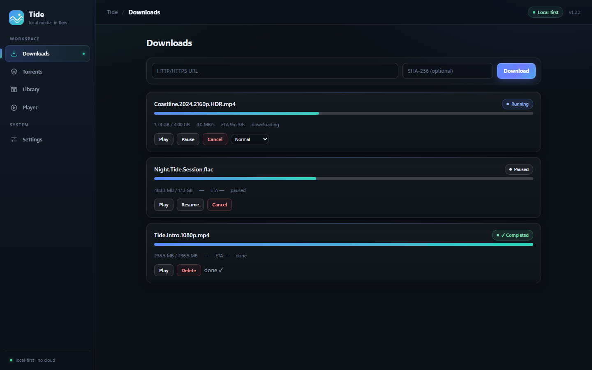

# ifuyo Tide

**Tide — Download. Watch. Flow.**

**English** · [简体中文](README.zh-CN.md)

A calm, local-first downloader and progressive media player for Windows.

> **Current release: 1.2.2.** The 1.0 feature set (M0–M12) is stable and
> validated end-to-end on real installers: fresh install, upgrade,
> uninstall, crash recovery, data preservation and security regression.
> 1.1/1.2 are maintenance and polish releases — see [CHANGELOG.md](CHANGELOG.md)
> for what changed. Open items and their dispositions are tracked in
> [KNOWN_ISSUES.md](KNOWN_ISSUES.md).



*Downloads view, English UI. The tasks shown are illustrative sample data
for this screenshot; Tide itself never fabricates progress — every number
in the app comes from the local engine.*

## What Tide is

Tide is a local Windows application (Tauri 2 + Rust + React + SQLite) built
around one idea: **you provide the source, Tide takes care of downloading,
managing, and playing it progressively.**

Tide is **local-first**: no account, no cloud backend, no telemetry, no
upload of your data. It does not provide or recommend content, does not
bypass DRM or paywalls, and does not claim to provide anonymity.

## Features

- **HTTP(S) downloads** with pause / resume / retry / cancel, checksum
  validation and crash-safe `.part` recovery.
- **BitTorrent** via librqbit: magnet links, `.torrent` files, per-file
  selection, public-trackers option and restart recovery.
- **Progressive playback**: press Play on a running task and watch while it
  downloads; seeking into not-yet-downloaded regions is requested on
  demand through one loopback gateway.
- **Local media library**: scan folders, search, filter, page, reveal in
  Explorer, re-check missing files.
- **Smart scheduler**: global bandwidth cap and per-task priorities.
- **Windows integration**: single instance, `tide://` deep links, `.torrent`
  association, tray, autostart, completion/failure notifications.
- **Bilingual UI** (English / 简体中文), switchable in Settings.
- **Honest failure UX**: structured error codes, no fake progress, no
  white screens from a single broken view.

## Usage

1. **Add a source**: paste an HTTP(S) URL in Downloads, or add a
   `.torrent` file / magnet link (or open it via `tide://add` / file
   association).
2. **Download**: pause/resume anytime; completed files are verified and
   imported into the Library.
3. **Watch while downloading**: press Play on a running task.
4. **Library**: browse, re-watch, reveal files in Explorer.
5. **Settings**: download directory, library folders, bandwidth limits,
   task priorities, language, Windows behaviors.

## Milestones

| Milestone | Feature | Status |
|---|---|---|
| M0 | Project skeleton, task domain, SQLite persistence, IPC, security baseline | done |
| M0.5 | Technology spike (streaming, WebView2 playback, librqbit feasibility) | done — full chain validated |
| M1 | HTTP/HTTPS download core | done — pause/resume/retry/checksum validated |
| M2 | Crash-safe persistence & resume | done — crash-injection tested |
| M3 | Torrent engine (librqbit) | done — loopback-swarm tested |
| M4 | Progressive streaming, Range gateway, demand scheduler | done — unified gateway, progressive play + seek |
| M5 | Player | done — controller/state machine/UI, reload recovery |
| M6 | Local media library | done — scanner/reconciler/imports/query UI |
| M7 | Smart scheduler | done — deterministic policy, real enforcement |
| M8 | Windows integration | done — single instance, deep links, tray, autostart, notifications |
| M9 | Product polish | done — error UX, boundaries, loading states, i18n |
| M10 | Security hardening | done — threat model, supply chain, debug surface removed |
| M11 | Release candidate & installer validation | done |
| M12 | 1.0.0 stable release | done |
| 1.1 / 1.2 | i18n, polish and maintenance fixes | current — see [CHANGELOG.md](CHANGELOG.md) |

## Requirements

- Windows 10 or 11, x64.
- WebView2 Runtime (bootstrapped by the setup EXE if missing; preinstalled
  on up-to-date Windows 10/11).
- No admin rights required (per-user install). No Node/Rust/Python or
  other developer tools for end users.

## Supported media

Playback uses the WebView2/Edge media stack of the host machine:

| Container | Codec | Status |
|---|---|---|
| MP4 | H.264 / AAC | Supported |
| WebM | VP9 / Opus | Supported |
| WebM | AV1 / Opus | Conditionally supported (varies by machine) |
| MKV | HEVC etc. | Conditionally supported (varies by machine) |

Unsupported codecs produce a structured error and offer the OS default
player as an escape path — never a crash.

## Installing, upgrading, uninstalling

- **Install**: run the `ifuyo-tide_*_x64-setup.exe` NSIS installer from
  the release artifacts (per-user, no admin rights; WebView2 bootstrapped
  if missing). Verify its SHA-256 against `SHA256SUMS.txt` in the same
  release bundle.
- **Data locations**: app data in `%LOCALAPPDATA%\ifuyo\Tide\`
  (database, logs, torrent metadata); downloaded files in the directory
  you choose. The two never share a root.
- **Upgrade**: close Tide, run the new installer over the old one —
  tasks, settings, library and downloaded files are preserved.
- **Uninstall**: Windows "Apps & features" or the Start-menu uninstaller —
  application files are removed; app data and downloads are preserved by
  default (explicit option to also remove app data).
- **Known limitations**: unsigned installer (SmartScreen prompt), no
  built-in updater — see [KNOWN_ISSUES.md](KNOWN_ISSUES.md).

## Troubleshooting

- **App does not open after an interrupted install or corrupt app data**:
  reinstall over the existing installation; if it still fails, back up
  `%LOCALAPPDATA%\ifuyo\Tide\database\tide.db` and remove the
  `%LOCALAPPDATA%\ifuyo\Tide` folder (your downloaded files are elsewhere
  and are not affected).
- **A video fails to play**: check the codec table above — Tide shows a
  structured decode error for unsupported codecs; try MP4 (H.264).
- **Downloads stall**: check the global/per-task bandwidth limits in
  Settings, and the task priority in the Downloads view.
- **Installer warning (SmartScreen)**: the installer is not code-signed
  yet (KI-3); verify the SHA-256 in the release checksum file.

## Architecture overview

```text
Frontend (React + TypeScript + Vite, WebView2)
        ↓ Tauri IPC (typed commands, structured errors)
Application Core (Rust)
        ↓
Domain (Task / Source / Resource / PlaybackSession / LibraryItem)
        ↓
Repository boundary
        ↓
SQLite (migrations, %LOCALAPPDATA%\ifuyo\Tide\database)
```

The download/playback chain
(`HTTP Engine / Torrent Engine → Resource → Availability → Scheduler →
Gateway → Player`) is one gateway and one player for every source kind.
Details: [docs/architecture/ARCHITECTURE.md](docs/architecture/ARCHITECTURE.md),
[docs/M4-stream-gateway.md](docs/M4-stream-gateway.md).

## Development setup

Prerequisites: Windows 11 x64, Node ≥ 20, pnpm, Rust (stable, MSVC),
VS Build Tools with C++ workload, WebView2 Runtime.

```powershell
pnpm install
pnpm tauri dev      # run the desktop app in dev mode
```

Build, typecheck and tests:

```powershell
pnpm build          # tsc --noEmit + vite build
pnpm test           # frontend render tests (vitest)
cd src-tauri
cargo check --locked
cargo test --locked
```

More detail: [docs/development/GETTING_STARTED.md](docs/development/GETTING_STARTED.md).

## Security

Tauri capabilities are minimal (`core:default` + directory picker only),
the CSP allows no remote scripts or CDNs, every IPC input is re-validated
in Rust, and the streaming gateway binds to loopback only with a
per-session capability token. Errors are structured `{code, message}` —
Rust internals, SQL errors and raw panics never reach the UI.

Report vulnerabilities privately (see [SECURITY.md](SECURITY.md)); open
security items are recorded in [KNOWN_ISSUES.md](KNOWN_ISSUES.md) as KI-1
(ringbuf advisory) and KI-2 (DNS-rebinding TOCTOU window).

## Privacy

Local-first. Tide does not send download URLs, magnets, info hashes, file
names, paths, content, history or behaviour anywhere. See
[PRIVACY.md](PRIVACY.md).

## Content policy

Tide is a general-purpose tool. It does not provide, search, index or
recommend content, and it does not bypass DRM or paywalls. Users are
responsible for having the necessary rights to the content they use with
Tide. See [CONTENT_POLICY.md](CONTENT_POLICY.md).

## License

The final license is **not yet decided** — [LICENSE](LICENSE) is an
explicit placeholder (development/evaluation only, no distribution
rights granted yet). It must be finalized before the first public
release. Third-party dependency licenses are tracked in
[THIRD_PARTY_NOTICES.md](THIRD_PARTY_NOTICES.md).
