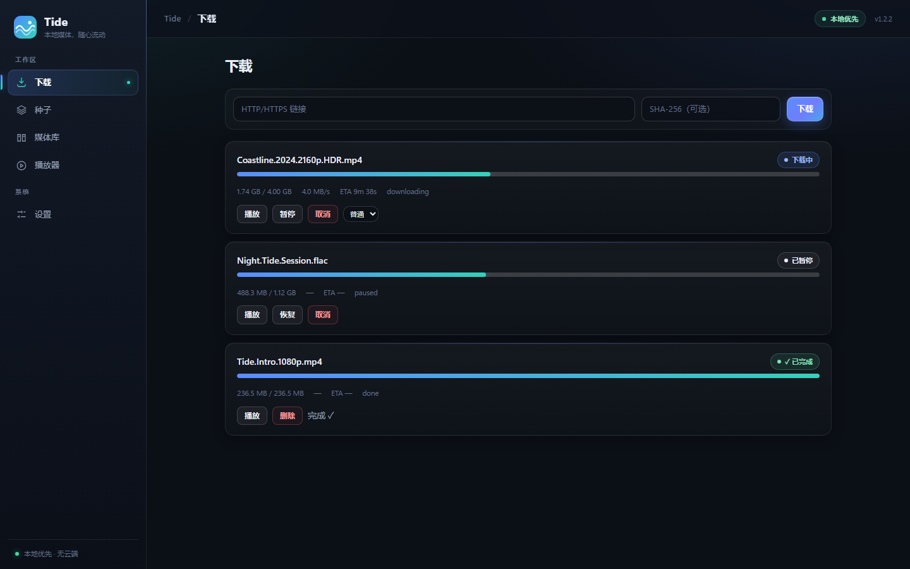

# ifuyo Tide

**Tide — 下载、观看、随流而动。**

[English](README.md) · **简体中文**

一款安静、本地优先的 Windows 下载器与渐进式媒体播放器。

> **当前版本：1.2.2。** 1.0 功能集（M0–M12）已稳定，并在真实安装包上
> 完成端到端验证：全新安装、升级、卸载、崩溃恢复、数据保留与安全回归。
> 1.1 / 1.2 为维护与体验优化版本，具体改动见
> [CHANGELOG.md](CHANGELOG.md)；未关闭问题及其处置说明见
> [KNOWN_ISSUES.md](KNOWN_ISSUES.md)。



*下载页，简体中文界面。截图中的任务为演示用示例数据；Tide 本身绝不伪造
进度——应用内每一个数字都来自本地引擎。*

## Tide 是什么

Tide 是一款本地 Windows 应用（Tauri 2 + Rust + React + SQLite），围绕一个
想法构建：**你提供来源，Tide 负责下载、管理，并在下载过程中渐进播放。**

Tide 坚持**本地优先**：无账号、无云端后端、无遥测、不上传你的数据。它不
提供或推荐内容，不绕过 DRM 或付费墙，也不宣称提供匿名性。

## 功能

- **HTTP(S) 下载**：暂停 / 恢复 / 重试 / 取消、校验和验证、崩溃安全的
  `.part` 断点续传。
- **BitTorrent**（librqbit）：magnet 链接、`.torrent` 文件、按文件选择、
  公共 tracker 开关、重启恢复。
- **渐进播放**：对正在下载的任务按「播放」，边下边看；跳转到尚未下载的
  区间时，由唯一的本地网关按需请求。
- **本地媒体库**：扫描文件夹、搜索、筛选、分页、在资源管理器中定位、
  重新检查丢失文件。
- **智能调度**：全局带宽上限与单任务优先级。
- **Windows 集成**：单实例、`tide://` 深链、`.torrent` 文件关联、托盘、
  开机自启、完成/失败通知。
- **双语界面**（English / 简体中文），可在设置中切换。
- **诚实的失败体验**：结构化错误码、不伪造进度、单个视图出错不会白屏。

## 使用流程

1. **添加来源**：在「下载」中粘贴 HTTP(S) 链接，或添加 `.torrent` 文件 /
   magnet 链接（也可通过 `tide://add` 或文件关联打开）。
2. **下载**：随时暂停 / 恢复；完成的文件经验证后导入媒体库。
3. **边下边看**：对运行中的任务按「播放」。
4. **媒体库**：浏览、重看、在资源管理器中定位文件。
5. **设置**：下载目录、媒体库文件夹、带宽上限、任务优先级、语言、
   Windows 行为。

## 里程碑

| 里程碑 | 功能 | 状态 |
|---|---|---|
| M0 | 项目骨架、任务领域、SQLite 持久化、IPC、安全基线 | 完成 |
| M0.5 | 技术验证（串流、WebView2 播放、librqbit 可行性） | 完成，全链路已验证 |
| M1 | HTTP/HTTPS 下载内核 | 完成，暂停/恢复/重试/校验和已验证 |
| M2 | 崩溃安全的持久化与续传 | 完成，崩溃注入测试 |
| M3 | 种子引擎（librqbit） | 完成，本地回环 swarm 测试 |
| M4 | 渐进串流、Range 网关、按需调度 | 完成，统一网关 + 渐进播放与跳转 |
| M5 | 播放器 | 完成，控制器/状态机/UI、重载恢复 |
| M6 | 本地媒体库 | 完成，扫描/对账/导入/查询界面 |
| M7 | 智能调度 | 完成，确定性策略与真实限速 |
| M8 | Windows 集成 | 完成，单实例、深链、托盘、自启、通知 |
| M9 | 产品打磨 | 完成，错误体验、错误边界、加载态、i18n |
| M10 | 安全加固 | 完成，威胁模型、供应链、移除调试命令 |
| M11 | 发布候选与安装包验证 | 完成 |
| M12 | 1.0.0 稳定版 | 完成 |
| 1.1 / 1.2 | 国际化、体验优化与维护修复 | 当前版本，见 [CHANGELOG.md](CHANGELOG.md) |

## 运行环境

- Windows 10 或 11，x64。
- WebView2 Runtime（缺失时安装包会引导安装；较新的 Windows 10/11 已
  预装）。
- 无需管理员权限（按用户安装）。最终用户无需 Node / Rust / Python 等
  开发工具。

## 支持的媒体格式

播放使用宿主机的 WebView2 / Edge 媒体栈：

| 容器 | 编码 | 状态 |
|---|---|---|
| MP4 | H.264 / AAC | 支持 |
| WebM | VP9 / Opus | 支持 |
| WebM | AV1 / Opus | 视机器而定 |
| MKV | HEVC 等 | 视机器而定 |

不支持的编码会返回结构化错误，并提供「用系统默认播放器打开」的出口，
不会崩溃。

## 安装、升级、卸载

- **安装**：运行发布包中的 `ifuyo-tide_*_x64-setup.exe`（NSIS，按用户
  安装，无需管理员权限；缺失时引导安装 WebView2）。请先对照同一发布包
  内 `SHA256SUMS.txt` 校验 SHA-256。
- **数据位置**：应用数据位于 `%LOCALAPPDATA%\ifuyo\Tide\`（数据库、
  日志、种子元数据）；下载文件位于你选择的目录。二者绝不共用根目录。
- **升级**：关闭 Tide，直接运行新安装包覆盖安装——任务、设置、媒体库
  与已下载文件均保留。
- **卸载**：通过 Windows「应用和功能」或开始菜单卸载项——移除程序文件；
  默认保留应用数据与下载文件（可显式勾选同时删除应用数据）。
- **已知限制**：安装包未签名（会触发 SmartScreen）、暂无内置更新器，
  详见 [KNOWN_ISSUES.md](KNOWN_ISSUES.md)。

## 故障排查

- **安装中断或应用数据损坏后无法启动**：先覆盖安装；若仍失败，备份
  `%LOCALAPPDATA%\ifuyo\Tide\database\tide.db` 后删除
  `%LOCALAPPDATA%\ifuyo\Tide` 目录（下载文件在别处，不受影响）。
- **视频无法播放**：核对上表编码；不支持时 Tide 会给出结构化解码错误，
  可尝试 MP4（H.264）。
- **下载停滞**：检查「设置」中的全局 / 单任务带宽上限，以及「下载」页
  中的任务优先级。
- **安装包警告（SmartScreen）**：安装包尚未代码签名（KI-3），请对照
  发布包中的校验和文件核验 SHA-256。

## 架构概览

```text
前端（React + TypeScript + Vite，WebView2）
        ↓ Tauri IPC（类型化命令、结构化错误）
应用核心（Rust）
        ↓
领域模型（Task / Source / Resource / PlaybackSession / LibraryItem）
        ↓
仓储边界
        ↓
SQLite（迁移脚本，%LOCALAPPDATA%\ifuyo\Tide\database）
```

下载 / 播放链路
（`HTTP 引擎 / 种子引擎 → Resource → Availability → Scheduler →
Gateway → Player`）对所有来源类型都只有**一个网关、一个播放器**。详见
[docs/architecture/ARCHITECTURE.md](docs/architecture/ARCHITECTURE.md)、
[docs/M4-stream-gateway.md](docs/M4-stream-gateway.md)。

## 开发搭建

前置条件：Windows 11 x64、Node ≥ 20、pnpm、Rust（stable，MSVC）、
带 C++ 工作负载的 VS Build Tools、WebView2 Runtime。

```powershell
pnpm install
pnpm tauri dev      # 以开发模式运行桌面应用
```

构建、类型检查与测试：

```powershell
pnpm build          # tsc --noEmit + vite build
pnpm test           # 前端渲染测试（vitest）
cd src-tauri
cargo check --locked
cargo test --locked
```

更多说明：[docs/development/GETTING_STARTED.md](docs/development/GETTING_STARTED.md)。

## 安全

Tauri 能力保持最小化（仅 `core:default` + 目录选择器），CSP 不允许远程
脚本或 CDN，所有 IPC 输入在 Rust 侧重新校验，串流网关仅绑定回环地址并
使用按会话生成的能力令牌。错误统一为结构化 `{code, message}`——Rust
内部信息、SQL 错误与原始 panic 不会进入界面。

漏洞请通过私下渠道报告（见 [SECURITY.md](SECURITY.md)）；未关闭的安全项
记录在 [KNOWN_ISSUES.md](KNOWN_ISSUES.md)：KI-1（ringbuf 公告）与
KI-2（DNS rebinding 的 TOCTOU 窗口）。

## 隐私

本地优先。Tide 不会把下载链接、magnet、info hash、文件名、路径、内容、
历史或行为发送到任何地方。详见 [PRIVACY.md](PRIVACY.md)。

## 内容政策

Tide 是通用工具：不提供、搜索、索引或推荐内容，不绕过 DRM 或付费墙。
使用者需自行确保对所使用内容拥有必要权利。详见
[CONTENT_POLICY.md](CONTENT_POLICY.md)。

## 许可证

最终许可证**尚未确定**——[LICENSE](LICENSE) 是明确的占位说明（目前仅
允许开发与评估，未授予分发权），首次公开发布前必须敲定。第三方依赖许可证
见 [THIRD_PARTY_NOTICES.md](THIRD_PARTY_NOTICES.md)。
